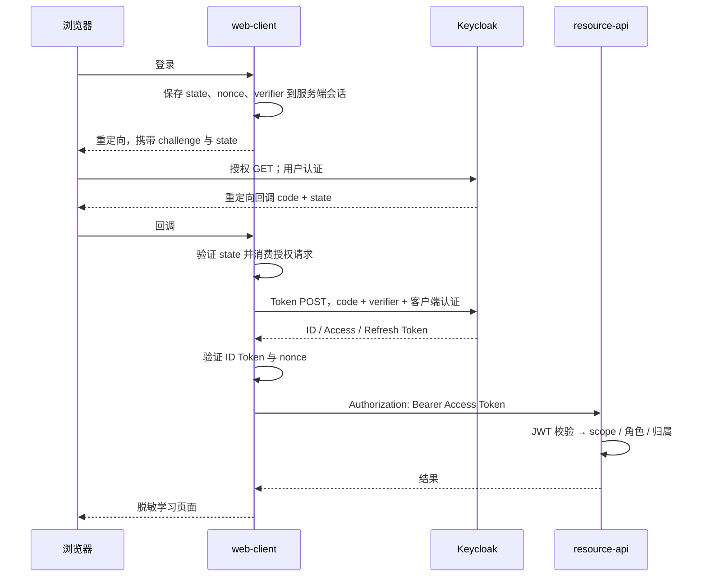

# 02 · Authorization Code + PKCE



下面是字段结构，方括号中的内容仅为占位符，不是可发送的凭据：

```http
GET /realms/auth-lab/protocol/openid-connect/auth?client_id=web-client&response_type=code&redirect_uri=http%3A%2F%2Flocalhost%3A8080%2Flogin%2Foauth2%2Fcode%2Fkeycloak&scope=openid%20profile%20orders%3Aread%20orders%3Awrite&state=[REDACTED]&nonce=[REDACTED]&code_challenge=[S256_CHALLENGE]&code_challenge_method=S256

POST /realms/auth-lab/protocol/openid-connect/token
Content-Type: application/x-www-form-urlencoded
Authorization: Basic [REDACTED_CLIENT_AUTH]

grant_type=authorization_code&code=[REDACTED]&redirect_uri=[EXACT_CALLBACK]&code_verifier=[REDACTED]
```

verifier 是安全随机字符串；`challenge = BASE64URL(SHA256(ASCII(verifier)))`。Base64URL 使用 `-`、`_` 替代 `+`、`/`，删除尾部 `=`，不是普通 Base64，也不是直接编码 verifier。网页 resolver 使用 Spring 的 `withPkce()`，即使 confidential client 有 secret 也显式开启；realm 也要求 S256。

state 绑定登录请求与浏览器会话以抵御登录 CSRF；nonce 绑定 ID Token 与此次 OIDC 请求。PKCE 绑定授权码与发起请求的一方，不能替代 state。匹配的回调消费服务端授权请求，重放不再有效。

## 可重复观察

1. 使用专门的演示浏览器会话开启登录，在开发者工具 Network 中确认授权请求**字段名称**及 `code_challenge_method=S256`；不要导出含凭据的 HAR 或截图。
2. token POST 由 Java 服务端发出，浏览器看不到。运行 `python3 scripts/e2e.py`，它直接创建独立测试会话，分别发送错误与正确 verifier，只报告成功/失败。
3. 用 `./gradlew :web-client:test --tests '*WebSecurityTest'` 验证真实 resolver 输出的 challenge 与 verifier 的 SHA-256 关系，以及 state 篡改与重放拒绝。

错误 verifier 的服务端 HTTP 400 / invalid_grant 由真实 Keycloak 验证；不要修改、拦截日常登录会话或开启敏感 HTTP 日志。
