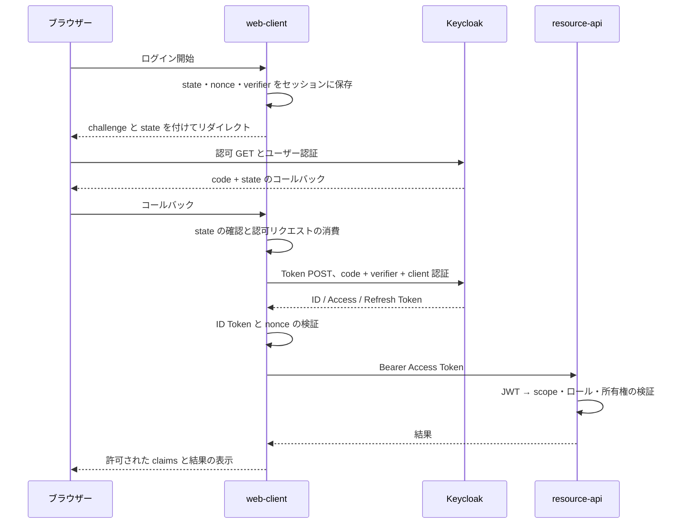

# 02 · Authorization Code + PKCE

[中文](../02-auth-code-pkce.md)



以下は構造の例です。角括弧内は認証情報の代わりのプレースホルダーです。

```http
GET /realms/auth-lab/protocol/openid-connect/auth?client_id=web-client&response_type=code&redirect_uri=[EXACT_CALLBACK]&scope=openid%20profile%20orders%3Aread%20orders%3Awrite&state=[REDACTED]&nonce=[REDACTED]&code_challenge=[S256_CHALLENGE]&code_challenge_method=S256

POST /realms/auth-lab/protocol/openid-connect/token
Content-Type: application/x-www-form-urlencoded
Authorization: Basic [REDACTED_CLIENT_AUTH]

grant_type=authorization_code&code=[REDACTED]&redirect_uri=[EXACT_CALLBACK]&code_verifier=[REDACTED]
```

verifier は安全な乱数から作ります。`challenge = BASE64URL(SHA256(ASCII(verifier)))` です。Base64URL は `+` と `/` を `-` と `_` に置き換え、末尾の `=` を除きます。verifier 自体の単純な Base64 ではありません。

Web は confidential client ですが `withPkce()` を明示し、Keycloak も S256 を要求します。state はリクエストとブラウザーセッションを対応付け、nonce は ID Token と今回の認証を結び付けます。PKCE は認可コードと開始者を結び付けます。互いの代わりにはなりません。対応するコールバックは保存済みリクエストを消費し、再利用できません。

## 確認手順

1. デモ専用セッションの開発者ツールで認可 GET のフィールド名と S256 を確認します。認証情報を含む HAR やスクリーンショットは保存しません。
2. token POST は Java サーバーが送信するため、ブラウザーには表示されません。環境変数を読み込んで `python3 scripts/e2e.py` を実行すると、独立セッションで正しい verifier と誤った verifier を検証できます。
3. `./gradlew :web-client:test --tests '*WebSecurityTest'` は実 resolver の challenge 計算、state 改変、コールバック再利用の拒否を検証します。

誤った verifier は実 Keycloak で HTTP 400 / invalid_grant になることを検証します。通常の利用セッションを傍受したり、機密 HTTP ログを有効にしたりしないでください。
